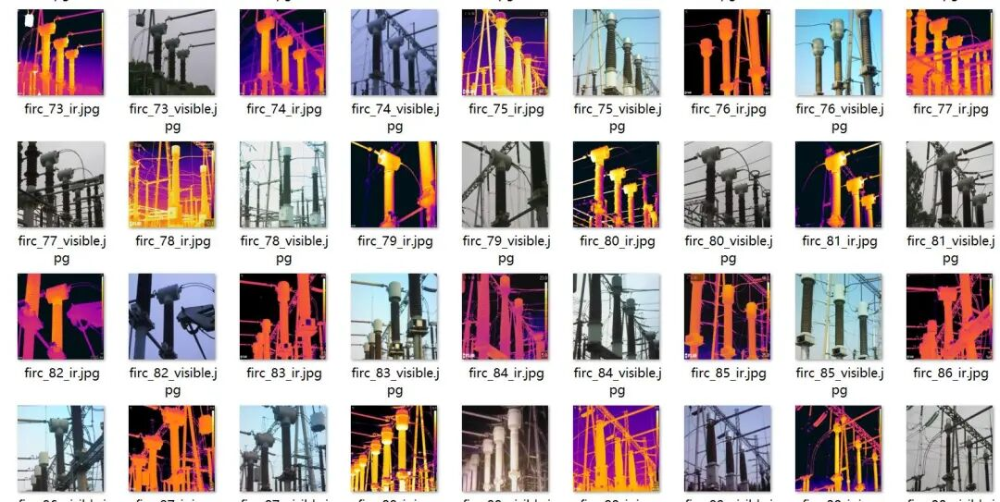
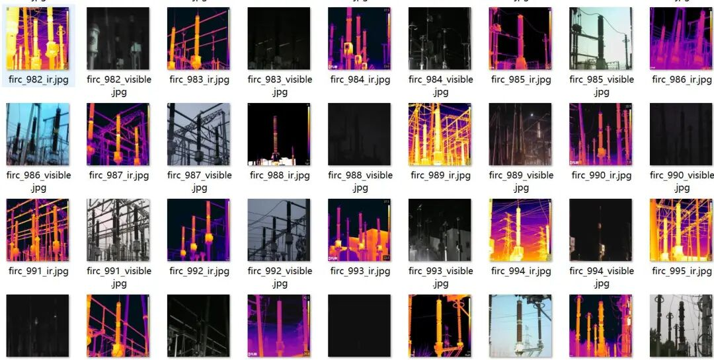
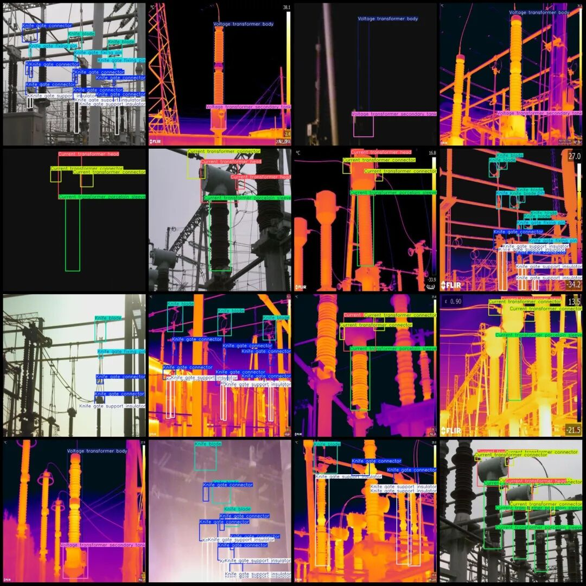
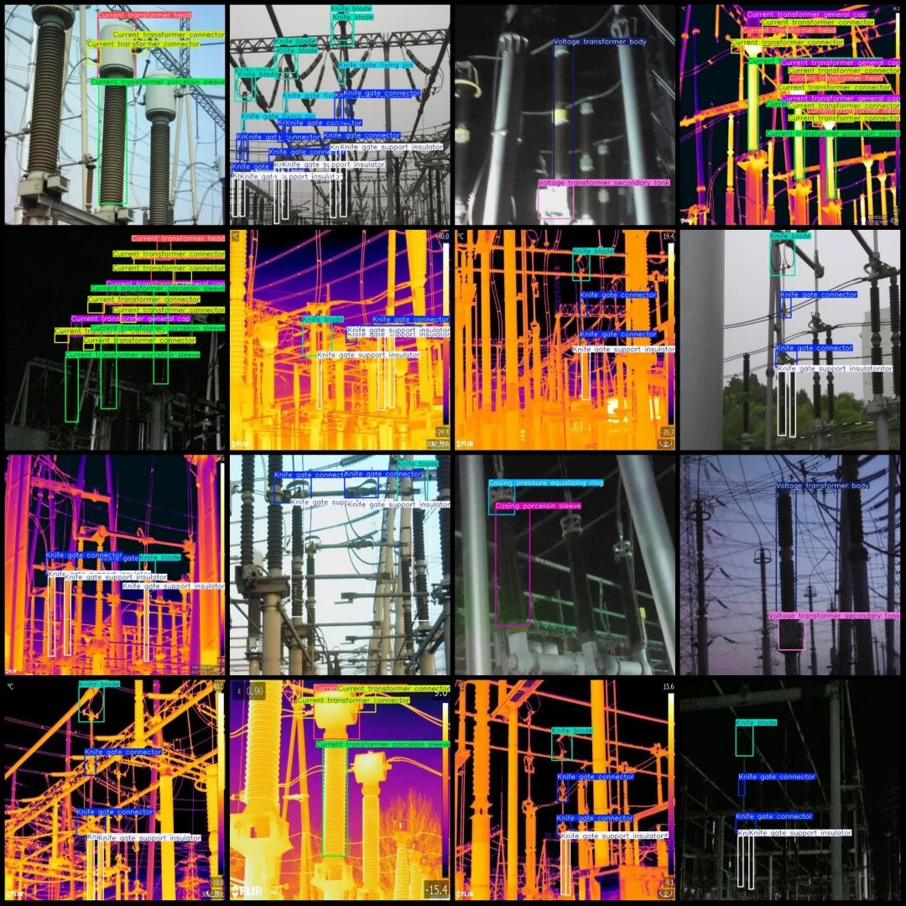

# Substation Infrared and Visible Light Paired Data Set for Valves, Circuit Breakers, Voltage Current Transformers, Lightning Shields, etc. Detection Data Set in VOC+YOLO format: 2354 images across 17 categories, 1177 pairs

Dataset format: Pascal VOC format + YOLO format (txt file without split path, only contains jpg images and corresponding VOC format xml files and yolo format txt files)

Number of images (number of jpg files): 2354

Number of annotations (number of xml files): 2354

Number of annotations (number of txt files): 2354

Labeling category count: 17

Label category name(NoteyoloThe format category order does not correspond to this, but instead...labelsFolderclasses.txtPrecision):["Arrester body","Arrester voltage equalizing ring","Casing connector","Casing general hat","Casing porcelain sleeve","Casing pressure equalizing ring","Current transformer connector","Current transformer general cap","Current transformer head","Current transformer porcelain sleeve","Current transformer secondary tank","Knife blade","Knife gate connector","Knife gate fixing pin","Knife gate support insulator","Voltage transformer body","Voltage transformer secondary tank"]

Number of boxes labeled in each category:

Arrester body (Leakage Current Relay Body) Frame Count = 6

Arrester voltage equalizing ring (Leakage Current Equalizer Ring) - Number of frames = 6

Casing connector (Coil connector) Frame count = 48

Casing general hat (Coil universal cap) Frame count = 56

Casing porcelain sleeve (Coil insulator) Frame count = 158

Casing pressure equalizing ring (casing equalizer ring) Frame count = 106

Current transformer connector (current transformer connection piece) frame count = 2106

Current transformer general cap (current transformer universal cap) frame number = 414

Current transformer head (current transformer head) frame count = 1040

Current transformer porcelain sleeve (current transformer porcelain sleeve) frame count = 1134

Current transformer secondary tank (current transformer secondary tank) Frame count = 100

Knife blade (blade) Frame count = 1256

Knife gate connector (Gate Connection) Frame count = 2346

Knife gate fixing pin (Gate Fixed Pin) Frame Count = 322

Knife gate support insulator (Gate Support Insulator) Frame Count = 2410

Voltage transformer body (voltage transformer body) Frame count = 880

Voltage transformer secondary tank (voltage transformer secondary tank) Frame count = 844

Total frame count: 13232

Number of images per category:

Arrester body (Leakage Current Relay Body) occupies = 2

Arrester voltage equalizing ring (Leakage Current Equalizer Ring) - Occupies a picture = 2

Casing connector (Coil connector) occupies the number of pictures = 36

Casing general hat ((Universal bushing) occupies a number of pictures = 44

Casing porcelain sleeve (Coil insulator) occupies a number of pictures = 98

Casing pressure equalizing ring (casing equalizing ring) occupies the image count = 58

Current transformer connector (current transformer connection piece) occupies the image count = 740

Current transformer general cap (current transformer universal cap) occupying picture count = 210

Current transformer head (current transformer head) occupies = 650

Current transformer porcelain sleeve (current transformer porcelain sleeve) occupies the image count = 738

Current transformer secondary tank (current transformer secondary tank) occupies = 96

Knife blade (blade) occupies 760 images

Knife gate connector (Gate Connection) occupies 770 images.

Knife gate fixing pin (Gate Fixed Pin) occupies = 164

Knife gate support insulator (Gate Support Insulator) occupies a picture count = 746

Voltage transformer body (voltage transformer body) occupies the number of pictures = 738

Voltage transformer secondary tank (voltage transformer secondary tank) occupies the image count = 716

Image resolution: 640x640

Using labelImg:

Annotation rules: Draw a rectangle around the category.

Important Notice: The dataset does not have separate training, validation, and test sets; you need to partition them yourself.

Special : This dataset does not guarantee the accuracy of the trained models or weight files.

Image Preview:

Annotation example:

## Payment

Here is a pay link on Stripe ( https://buy.stripe.com/3cs8yP7sY87d0vu9AB ). Please contact me lonlonago@foxmail.com after funding $89, and I will send you a complete data files , thank you!

